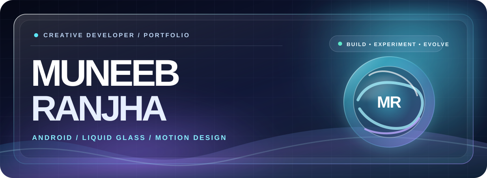
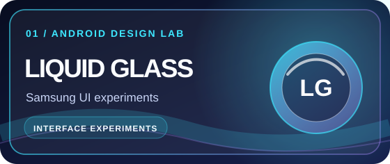
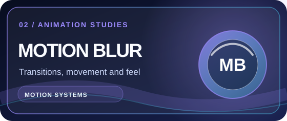
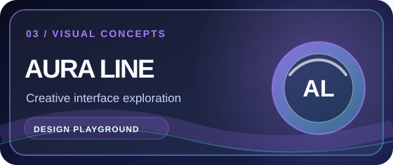
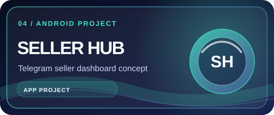
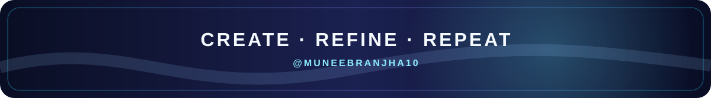

 

 

Profile-views badge is a design showcase, not a live visitor count.

---

### 01 / ABOUT ME  ✦

Hey, I'm **Muneeb** — also known as **Astro** here. I'm into bold Android interfaces, slick motion, and finding ways to make everyday tech look extraordinary.

I use this space to share UI experiments, prototypes, Android projects, and ideas in progress. It's a workshop, not a showroom full of finished releases.

- **Design language:** midnight backgrounds, luminous gradients, and liquid-glass depth
- **Interests:** Android UI, custom animations, system-level experimentation, developer tools
- **Approach:** build → test → improve → share
- **Currently exploring:** interfaces that feel as good as they look

### 02 / TOOLS & INTERESTS  ⌘

### 03 / FEATURED PROJECT LAB  ◈

<b>✦ Explore these projects</b>

| Repository | Focus |
| :-- | :-- |
| [Samsung Liquid Glass](https://github.com/muneebranjha10/Samsung-Liquid-Glass) | Glass-inspired Android UI customization experiments |
| [Motion Blur](https://github.com/muneebranjha10/Motion-Blur) | Motion and animation concepts |
| [Aura Line](https://github.com/muneebranjha10/Aura-line) | Visual ideas and interface exploration |
| [Telegram Seller Hub](https://github.com/muneebranjha10/Github-apkk) | Android seller-management app project |

> **Work in progress:** Many repositories are design studies or experimental builds. See each repo for current features, status, and instructions.

### 04 / GITHUB ACTIVITY  ↗

These charts use a third-party stats service and may not always load.

### 05 / LET'S BUILD  ✳

If you're into Android customization, experimental interfaces, or creative open-source projects, feel free to explore the repos and follow along.

  

